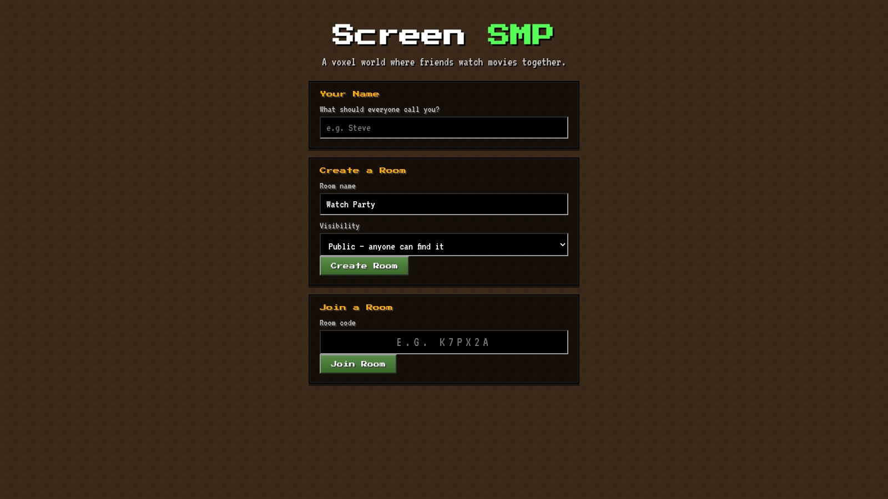
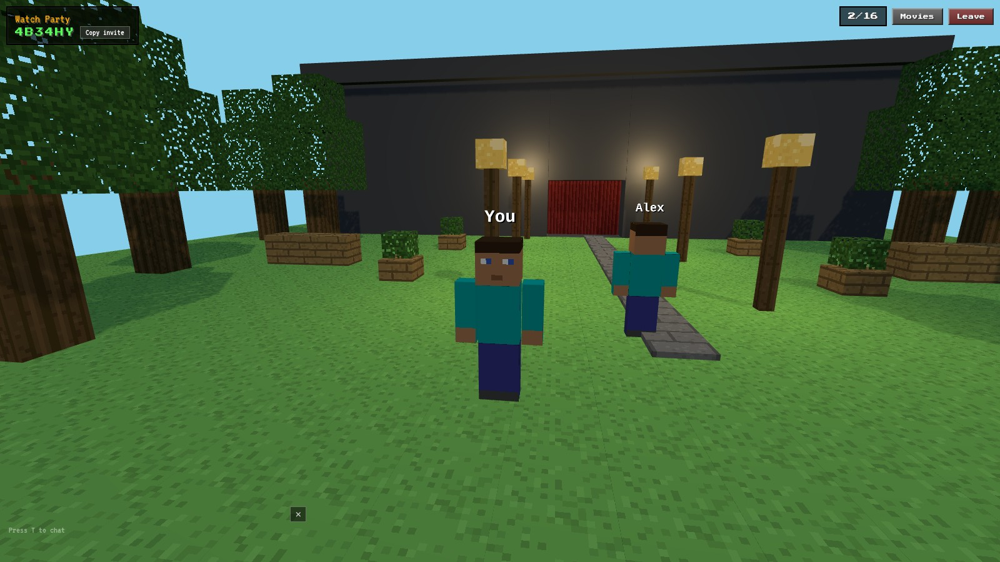
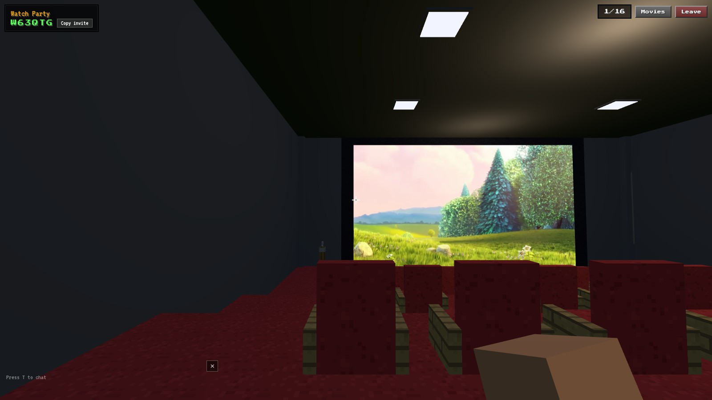
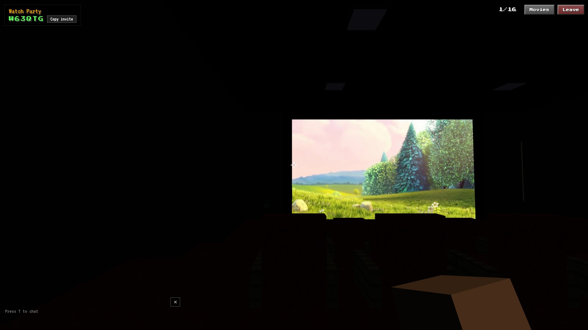

<p align="center">
  
</p>

# Screen SMP

**A Minecraft-style voxel world where your friends actually show up — and the movie plays for everyone, in sync.**

Grab a room code, walk into the theatre, claim a red seat, punch your buddy in the head,
kill the lights, and watch. No accounts, no installs — it's a website.

<p align="center">
  
  <br><sub>You and Alex, outside the theatre. Room code's in the corner — send it to a friend.</sub>
</p>

## The pitch

- 🎬 **A real movie night** — a giant voxel screen inside a proper dark theatre, red stadium
  seats, curtains, and a light lever that actually kills the lights for everyone.
- ⛓️ **One timeline for everybody** — play, pause, seek: the host drives, everyone else is
  glued to the same frame. Late joiners get warped to the current timestamp.
- 🌐 **Play almost anything** — paste a YouTube link, Vimeo, a raw MP4, HLS/DASH, or just a
  video page and the server resolves it with `yt-dlp`. Built-in catalog of open-license
  Blender films included, zero setup. (DRM streams are refused with a friendly shrug.)
- 🧍 **Your Minecraft skin** — type your username, your real skin loads from Mojang's API.
  Or upload any 64×64 PNG. Steve is the fallback for the nameless.
- 💬 **It's a multiplayer server too** — chat, `/sit`, `/wave`, punch to sync an emote to
  everyone, Tab for the player list, public rooms you can just browse into.

<p align="center">
  
  <br><sub>Lights on, film rolling.</sub>
</p>

<p align="center">
  
  <br><sub>Lights off. Now it's a cinema.</sub>
</p>

## Controls

| Input | Action |
|-------|--------|
| **WASD** + mouse | Move / look (double-tap **W** to run) |
| **Shift** / **Space** | Crouch / jump |
| **E** (aim at a chair) | Sit down — **E** again to stand |
| **E** (anywhere else) | Movie settings — paste links, play/pause, seek |
| **E** (at the light lever) or **L** | Theatre lights on/off |
| **Right click** | Punch (everyone sees it) |
| **F5** | First-person ↔ third-person |
| **F** | Full-screen video mode (the movie takes over the window) |
| **T** / **/** · **Tab** · **Escape** | Chat · player list · release mouse |
| **/sit** / **/wave** / **/help** | Chat commands |

## Quick start

```bash
npm install
npm run dev          # server :4000 + client :5173
```

Open **http://localhost:5173** in two windows, create a room in one, join with the code in
the other. That's genuinely all it takes.

> `yt-dlp` on PATH is only needed for pasted links (YouTube/Vimeo/pages). The built-in
> catalog works without it.

### Run it for real

```bash
npm run build        # client → client/dist, server → server/dist
npm start            # NODE_ENV=production, serves everything on one origin (:4000)
```

Or ship it with Docker:

```bash
docker build -t screen-smp .
docker run -p 4000:4000 screen-smp
```

One process, one port — the server serves the built client, so there's no CORS to
configure. Point a host at it (there's a `render.yaml` for Render, and the image runs
anywhere that takes a Dockerfile) and share the URL.

### Environment

Defaults work for local dev. `.env.example` has the full list.

| Var | Default | Purpose |
|-----|---------|---------|
| `PORT` | `4000` | Game server port |
| `CLIENT_ORIGIN` | `http://localhost:5173` | Allowed browser origins (comma-separated in prod; leave unset to reflect everything) |
| `VITE_SOCKET_URL` | `/` (same origin) | Socket URL baked into the client build (only needed if client & server are on different origins) |
| `YOUTUBE_COOKIES_B64` | unset | Optional — base64 of a Netscape `cookies.txt` from a logged-in YouTube session. Only needed if YouTube bot-checks your server's IP ("Sign in to confirm you're not a bot"); the image already ships a PO-token provider for the usual case. `base64 -w0 cookies.txt` to encode. |

## Tech

| Layer | Stack |
|-------|-------|
| Client | Vite · React 18 · TypeScript · Three.js · socket.io-client |
| Server | Node · Express · Socket.IO · TypeScript |
| Video | `yt-dlp` resolver → `/api/stream` same-origin proxy (range requests, segment cache, HLS/DASH), `hls.js`/`dashless` in the player, single-`<video>` pipeline |
| State | Authoritative in-memory rooms on the server — positions at 10 Hz, interpolated remotes, timestamped playback with drift correction |
| Tests | `node:test` — **30/30 passing** (`npm test`) |

### How sync works (the short version)

The server owns the room: membership, host role, positions (clamped to the world),
chat, and the canonical playback state with a timestamp. Clients send movement at 10 Hz
and interpolate everyone else. Playback carries a server time; each client estimates
where the video *should* be and only corrects when it drifts past 1.5 s — so no
annoying per-frame seeking. Host disconnects, the host role passes to whoever joined
first. Empty rooms get garbage-collected.

## What's not here (yet)

- **Voice chat** — mic levels tint your name tag green (speaking indicator), but actual
  WebRTC voice is a next step, not an MVP step.
- **Accounts / database** — rooms are in-memory and ephemeral. Guest life only.
- **Mobile controls** — touch-look exists in the engine; a virtual joystick doesn't.

## License notes

Sample films are Blender Foundation open movies (CC-BY). All voxel/character art is
generated procedurally at runtime — no Minecraft assets, textures, or branding are
bundled, and skins come from your own Mojang account data.
